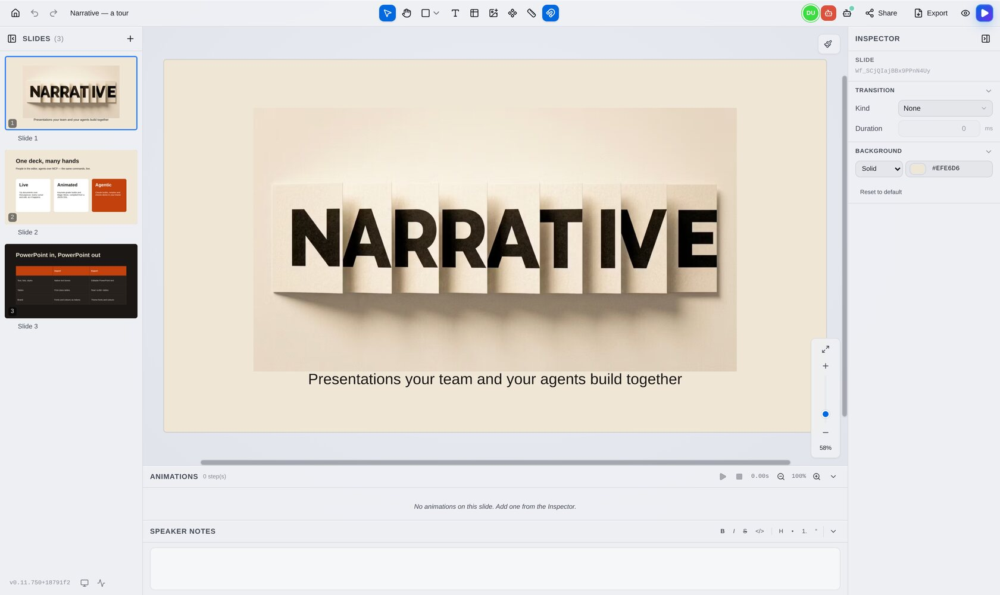
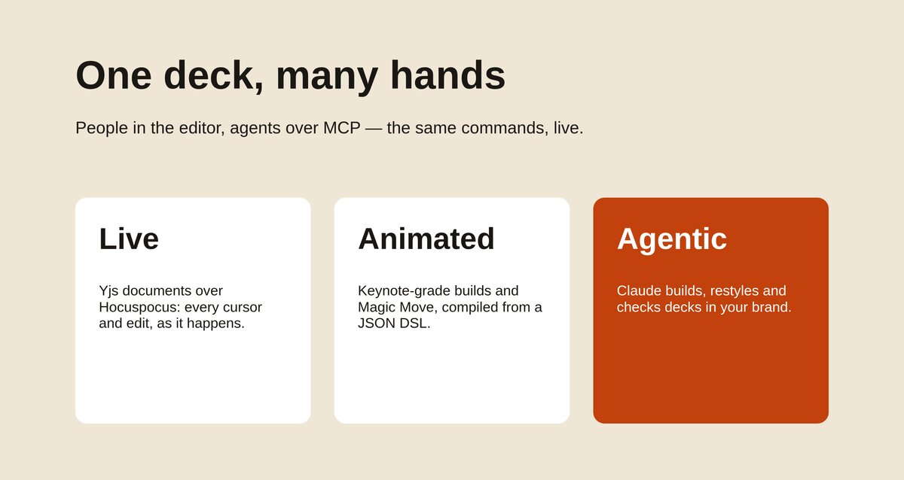
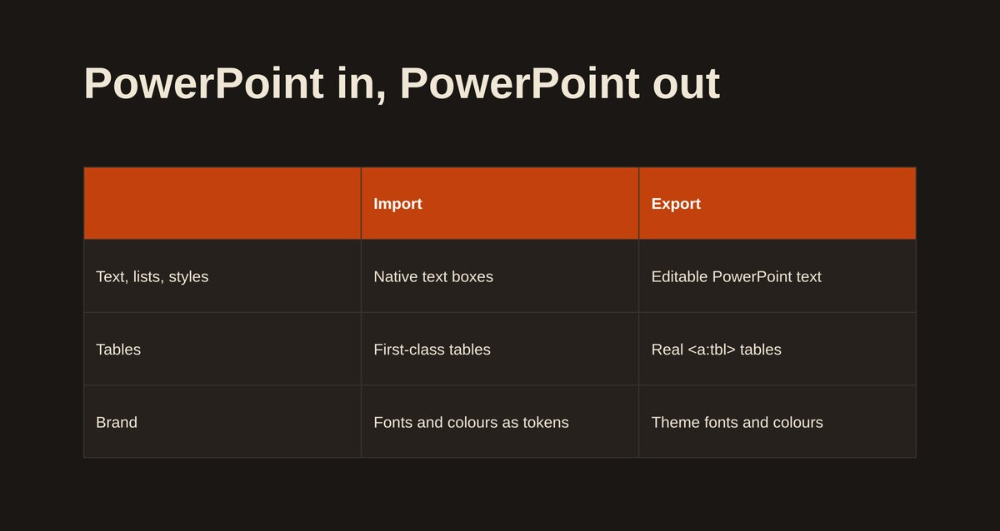
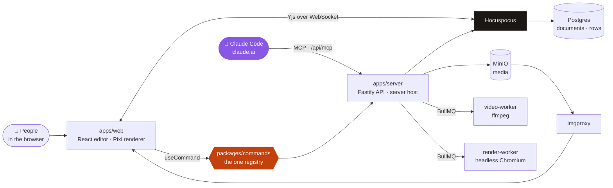

<div align="center">


### Presentations your team and your agents build together.

[](CHANGELOG.md)
[](tsconfig.base.json)
[](docs/adr/0002-renderer-architecture.md)
[](docs/adr/0003-yjs-slide-model.md)
[](docs/mcp.md)
[](docs/deploy.md)
[](LICENSE)

A self-hosted, real-time collaborative presentation editor with
**Keynote-grade animations**, **native tables**, **PowerPoint round trip**
and **brand style packs** — and an agentic layer through which **Claude
builds, edits and restyles decks** over MCP, with exactly the commands a
person uses in the editor.

[**Quick start**](#-quick-start) · [**Agents**](#-agents-mcp) · [**Docs**](#-documentation) · [**Changelog**](CHANGELOG.md) · [**Setup**](SETUP.md)

</div>

---

<p align="center">
  
</p>

## ✨ What it is

Narrative is the deck tool of [Woodgrove Digital](https://woodgrove.com)'s design
department, built for small teams (up to ~15 editors at once) on their own
infrastructure. Every deck is a **Yjs document** synced live through
Hocuspocus and drawn by a **PixiJS** renderer; every change — from a person,
a script or a model — goes through **one command registry**, so an agent can
do precisely what a person can, and every agent run can be reverted from the
editor.

> Narrative runs no model. Claude Code and claude.ai drive it through its MCP
> server, so the model, its key and its bill stay in the user's own Claude
> client ([ADR 0011](docs/adr/0011-agent-execution-over-mcp.md)).

## 🎯 What it does

| Area                      | What you get                                                                                                                                                                          |
| ------------------------- | ------------------------------------------------------------------------------------------------------------------------------------------------------------------------------------- |
| 👥 **Live collaboration** | Yjs CRDT documents over Hocuspocus: cursors, selections and edits of everyone in the deck as they happen; per-run undo for agents                                                     |
| 🖼 **Canvas**             | Text, shapes, lines and arrows, editable paths, images with crop and masks, video, tables, groups, guides, gradients, shadows, page numbers, object locks                             |
| 🎬 **Animation**          | Builds and slide transitions from a JSON DSL compiled to GSAP, a timeline panel, **Magic Move** between slides ([M13](docs/handoff/M13-magic-move.md))                                |
| 🧩 **Components**         | Reusable masters stamped into decks, with media the master owns ([ADR 0012](docs/adr/0012-component-owned-media.md))                                                                  |
| 🎨 **Style packs**        | A folder's brand — fonts, colour and text-style tokens, layouts, grid — that agents build into and check against ([A4](docs/plans/a4-style-packs.md))                                 |
| 📊 **PowerPoint**         | Import and export through one translation in both directions: editable text, real tables, theme fonts and colours ([ADR 0009](docs/adr/0009-pptx-one-translation-both-directions.md)) |
| 📤 **Export**             | PPTX, PNG per slide (headless Chromium render worker, [A3](docs/plans/a3-render-worker.md)) and PDF                                                                                   |
| 📽 **Present**            | Full-screen presenting with presenter view, a pop-out window and share links that present                                                                                             |
| 🔐 **Sharing**            | Google sign-in, folders with roles, deck shares, invites and revocable links ([ADR 0013](docs/adr/0013-folder-sharing-roles.md), [auth](docs/auth.md))                                |
| 🤖 **Agents**             | Every capability is an MCP tool; irreversible actions are confirmed by a person, never by the model ([`docs/mcp.md`](docs/mcp.md))                                                    |
| 🏗 **Deck builder**       | _Built, not released yet_: a whole deck from a brief in the folder's brand, restyling other brands' slides into it (CHANGELOG → [Unreleased](CHANGELOG.md))                           |

<table>
  <tr>
    <td></td>
    <td></td>
  </tr>
  <tr>
    <td align="center"><sub>Presenting — a slide built entirely through the command API</sub></td>
    <td align="center"><sub>A native table, exported as a real PowerPoint table</sub></td>
  </tr>
</table>

## 🧭 How it fits together



- **State is Yjs only**; mutations live in `packages/slide-model`, and the
  editor writes documents only through `useCommand()` (the one-door lint rule).
- **Every user capability is a command** with a zod schema, a model-quality
  description and runnable examples
  ([ADR 0010](docs/adr/0010-command-layer-is-the-only-writer.md)); parity
  guards fail the build when a route, control or mutation has none. The full
  list: [`docs/capabilities.md`](docs/capabilities.md).
- **Rendering is a SceneGraph diff** onto Pixi
  ([ADR 0004](docs/adr/0004-renderer-reconciler.md)), and the production CSP
  is a hard constraint on it ([ADR 0007](docs/adr/0007-csp-as-a-renderer-constraint.md)).

The rules every change keeps are in [`AGENTS.md`](AGENTS.md) → Hard rules.

## 🚀 Quick start

You need Node ≥ 24.4 with type stripping, pnpm 9.15.4, Docker with Compose
(logged in to GHCR once for the MinIO mirror), `just`, `lefthook`,
`gitleaks`, `xmllint` and python3 — `just doctor` checks all of it and prints
the fix. [SETUP.md](SETUP.md) is the full first-run guide.

```bash
git clone https://github.com/petronijus/Narrative.git && cd Narrative
git clone https://github.com/petronijus/Narrative-private.git private   # secrets overlay (team only)
just setup                       # pnpm install, git hooks, just doctor
scripts/secrets-decrypt.sh dev   # .env from the overlay — without it: cp .env.example .env (SETUP.md §2–3)
just services                    # Postgres, MinIO + bucket, imgproxy, Redis
just dev                         # web :5173 · API :3001 · WebSocket :3002 · video + render workers
```

```bash
curl http://localhost:3001/health   # {"status":"ok"}
```

Open <http://localhost:5173>: with `BYPASS_AUTH=true` you are `dev-user`,
no sign-in. Migrations apply when the server starts.

> One dev stack per machine: the compose containers have fixed names, so
> `just services` from a second checkout recreates the first one's containers
> (SETUP.md → Common first-run failures).

## 🤖 Agents (MCP)

The MCP server is part of the API — `https://<domain>/api/mcp` in production,
`http://localhost:3001/mcp` in dev. Every tool is generated from the command
registry and runs on the server with the calling user's role, as one change,
logged to a run the user can revert from the editor's Agent activity popover.

- **Claude Code** — account menu → **Access tokens** → a token with the `mcp`
  scope, then
  `claude mcp add --transport http narrative https://<domain>/api/mcp --header "Authorization: Bearer <token>"`.
  Without the header it signs in with OAuth instead.
- **claude.ai** — Settings → Connectors → Add custom connector →
  `https://<domain>/api/mcp`, sign in with Google and approve on Narrative's
  consent page.
- **The `narrative` Claude Code plugin** ([`claude-plugin/`](claude-plugin/))
  carries the skill and the playbooks (build a deck, restyle, translate, …),
  generated from `packages/commands/playbooks/`.
- **Scripts** use the same registry over `POST /api/commands` with an `api`
  token.

Sharing, invitations, deletes, moving a deck and URL downloads are confirmed
by the user — in the client or on Narrative's confirmation page. Reference:
[`docs/mcp.md`](docs/mcp.md); local setup: [SETUP.md](SETUP.md) §9.

## 🧪 Checks

There is no hosted CI — `just ci` is the CI, run locally; the pre-push hook
runs `just check`.

```bash
just check            # fast lane: formatting, types, lint, docs check, every unit test, the capability manifest
just test server web  # unit tests of some packages
just e2e-affected     # the Playwright specs the current change needs (against `just dev`)
just ci               # check + integration + the full e2e suite
just eval             # agent eval: headless Claude Code scenarios, graded from the document (costs usage)
```

What each suite covers and what is deliberately not tested:
[`docs/testing-strategy.md`](docs/testing-strategy.md). Which lane a change
needs: [`AGENTS.md`](AGENTS.md) → When to run what.

## 📦 Releases and production

One version flows through everything: `package.json` = git tag `vX.Y.Z` =
GHCR image tag = `/version.json`
([ADR 0008](docs/adr/0008-release-and-image-tag-discipline.md)). A release is
`just bump X.Y.Z`, a CHANGELOG section, commit → tag → push, then
`just deploy vX.Y.Z`: images are built off the production host, pushed to
private GHCR packages and pulled by the VM behind a Cloudflare Tunnel.

[`docs/deploy.md`](docs/deploy.md) has the topology, secrets (SOPS in the
private overlay), rollback and troubleshooting;
[`docs/ops.md`](docs/ops.md) the runbook (health, metrics, Sentry, backups).

## 📚 Documentation

| Doc                                                           | What's in it                                                          |
| ------------------------------------------------------------- | --------------------------------------------------------------------- |
| [SETUP.md](SETUP.md)                                          | First run, everyday development, git hooks, first-run failures, ports |
| [AGENTS.md](AGENTS.md)                                        | Hard rules, commands, when to run what — for every coding agent       |
| [docs/testing-strategy.md](docs/testing-strategy.md)          | The test suites and what they cover                                   |
| [docs/agents.md](docs/agents.md)                              | Areas of the code and their owner agents                              |
| [docs/mcp.md](docs/mcp.md)                                    | The MCP server: auth, OAuth, tools, confirmation, rate limits         |
| [docs/capabilities.md](docs/capabilities.md)                  | Every command (generated by `just capabilities`)                      |
| [docs/auth.md](docs/auth.md)                                  | Google sign-in, who may sign in, tokens, ingress                      |
| [docs/storage.md](docs/storage.md)                            | MinIO, imgproxy, the bucket layout, the video pipeline                |
| [docs/deploy.md](docs/deploy.md) · [docs/ops.md](docs/ops.md) | Releasing, production, operations                                     |
| [docs/adr/](docs/adr/)                                        | Architecture decisions                                                |
| [docs/plans/](docs/plans/) · [docs/handoff/](docs/handoff/)   | Multi-phase plans and the per-milestone handoffs                      |
| [BUILD_PLAN.md](BUILD_PLAN.md)                                | The original milestone roadmap and stack decisions                    |
| [CHANGELOG.md](CHANGELOG.md)                                  | Every release                                                         |
| [docs/brand/](docs/brand/)                                    | The logo and how the app icons are cut from it                        |

## 🗂 Repository layout

```
apps/web            React editor, Pixi renderer (src/renderer), Playwright e2e (e2e/)
apps/server         Fastify API, Hocuspocus, MCP server, services, drizzle/ migrations
apps/video-worker   ffmpeg video processing (BullMQ)
apps/render-worker  headless Chromium on the render page: slide PNGs (BullMQ)
packages/shared     object types and zod schemas
packages/slide-model  Yjs document model and writers
packages/commands   command registry, parity guards, playbooks, capability manifest
packages/animation  animation DSL and GSAP compiler
claude-plugin/      the generated `narrative` Claude Code plugin
tests/              agent eval (agent-eval/), load tests, fixtures
infra/              docker compose, deploy and build scripts
tools/dev/          formatter, docs check, git hook scripts, toolchain doctor
```

## 📜 License

[PolyForm Noncommercial License 1.0.0](LICENSE) — source-available for
**noncommercial** use (personal, research, evaluation); commercial use is
not granted. [`NOTICE`](NOTICE) also covers the GSAP dependency's separate
(non-open-source) license.
